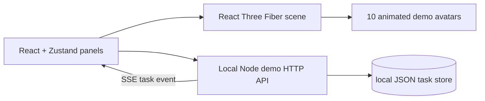
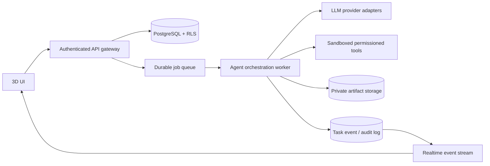

# Architecture: Current starter and intended platform

## Current (real)



- Web: React, Vite, TypeScript, Three.js/React Three Fiber, Drei, CSS, Zustand.
- Dev-only backend: Node.js HTTP server with atomic JSON file and Server-Sent Events.
- Demo avatars are procedurally modelled characters. Movement is scripted within a radius, **not collision-aware pathfinding**.
- No production architecture claims apply to this code.

## Target (not yet implemented)



### Non-negotiable contracts for Phase 2

- `task.created`, `task.assigned`, `run.started`, `llm.requested`, `tool.started`, `tool.finished`, `approval.requested`, `artifact.created`, `run.completed`, `run.failed`, `run.cancelled`.
- Event shape: `event_id`, `organization_id`, `task_id`, `run_id`, `agent_id`, `type`, `occurred_at`, `sequence`, `payload_version`, `payload`.
- Server is the only source of truth. UI maps backend run states to avatar animation; UI animation never changes task status.
- Idempotency per command, retries only for replay-safe operations, bounded concurrency, cancellation tokens, cost budgets, audit trail.
- Multi-tenant organization scoping, Supabase Auth + PostgreSQL RLS + private Storage; server-authorized tool scopes.
- Provider API keys encrypted and managed server-side; no credentials in browser bundles, client state, logs, or git.
- LLM executes only after explicit connection and approval rules; no auto-publishing or external irreversible actions.

### Provisional stack choices requiring validation

- Supabase Auth/Postgres/Storage/Realtime as specified in master prompt.
- Durable queue candidate: `pg-boss` or `BullMQ` (select after constraints and hosting are validated).
- Worker's provider adapters should support Responses-style and other provider APIs by capability, not assume chat-completions.
- Artifact validation/checksum; signed access control; sandbox for code and file operations.

### Scene graph concept

```text
Campus
  Terrain / paths / landscaping
  MainOffice (building shell / desks / selectable roof)
  InnovationLab
  Lounge
  Pool
  Characters[10] / animation controllers
  CameraRig
  Lights / Fog
```

Reference blueprint is `docs/MASTER_PROMPT.md`. Current starter implements only a small part of that blueprint.
